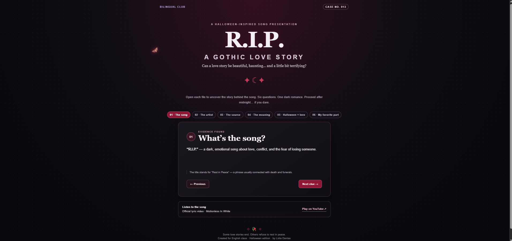

# Bilingual Club — R.I.P. | Halloween Edition

## English

An interactive website created for an English class presentation about **“R.I.P.” by Motionless In White featuring Skylar Grey**.

With a gothic, Halloween-inspired visual style, the project explores the song, its artists, its themes, and the connection between romance and darker imagery. Visitors can navigate through six presentation questions and open the music video.

### Features

- Interactive navigation between presentation questions
- Gothic, Halloween-inspired design
- Animated bat
- Link to the music video
- Responsive layout

### Technologies

- HTML
- CSS
- JavaScript

### Preview

### Run locally

Download or clone this repository, then open `index.html` in your browser.

---

## Português (Brasil)

Um site interativo desenvolvido para uma apresentação de inglês sobre **“R.I.P.”, da banda Motionless In White com participação de Skylar Grey**.

Com uma identidade visual gótica inspirada no Halloween, o projeto apresenta a música, seus artistas, seus temas e a relação entre romance e elementos sombrios. A navegação permite explorar seis perguntas sobre a canção e acessar o videoclipe.

### Funcionalidades

- Navegação interativa entre as perguntas da apresentação
- Design gótico inspirado no Halloween
- Animação de um morcego
- Link para o videoclipe
- Layout adaptável a diferentes telas

### Tecnologias

- HTML
- CSS
- JavaScript

### Pré-visualização

### Como executar localmente

Baixe ou clone este repositório e abra o arquivo `index.html` no navegador.

---

Developed by Lidia Dantas for an English class project.
